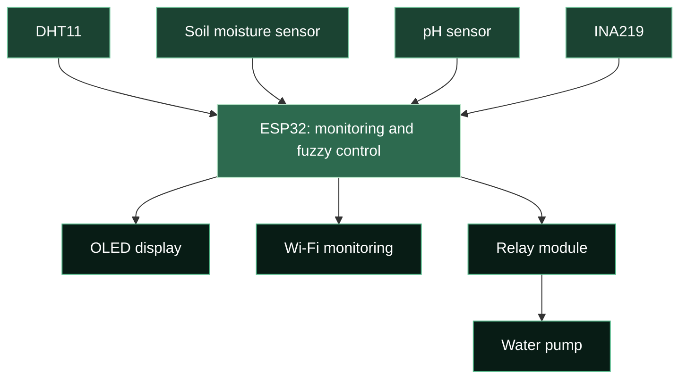

<!-- ANIMATED HEADER -->

  

<h1 align="center">🌱 Smart Irrigation System</h1>

<h3 align="center">
  ESP32 · Environmental Monitoring · Fuzzy Logic · Solar Power
</h3>

  

  <b>Connecting soil, sensors, and irrigation through embedded intelligence.</b>

  
  
  
  

  <a href="#overview">Overview</a> ·
  <a href="#features">Features</a> ·
  <a href="#system-overview">System Overview</a> ·
  <a href="#prototype">Prototype</a> ·
  <a href="#hardware-components">Hardware</a> ·
  <a href="#pin-connections">Connections</a> ·
  <a href="#applications">Applications</a>

---

<h2 align="center">Overview</h2>

  An <b>ESP32-based IoT Smart Irrigation System</b> that combines
  environmental sensing, automatic irrigation control,
  and wireless monitoring for smart farming applications.

  The system monitors <b>soil moisture, temperature, humidity,
  soil pH, and solar panel voltage</b>.
  It uses <b>fuzzy logic</b> for automatic irrigation control
  and <b>ESP32 Wi-Fi</b> for wireless monitoring.

  <code>SENSE</code>
  &nbsp; → &nbsp;
  <code>PROCESS</code>
  &nbsp; → &nbsp;
  <code>CONTROL</code>
  &nbsp; → &nbsp;
  <code>MONITOR</code>

---

<h2 align="center">Features</h2>

<table align="center">
  <tr>
    <td width="50%" align="center" valign="top">
      <h3>🌱 Soil Monitoring</h3>
      

        Monitor soil moisture and pH to observe
        conditions around the irrigation area.
      

      

        <code>Soil Moisture</code>
        <code>Soil pH</code>
      

    </td>
    <td width="50%" align="center" valign="top">
      <h3>🌡️ Environmental Sensing</h3>
      

        Measure temperature and humidity
        using the DHT11 sensor.
      

      

        <code>Temperature</code>
        <code>Humidity</code>
      

    </td>
  </tr>
  <tr>
    <td width="50%" align="center" valign="top">
      <h3>🧠 Automatic Irrigation</h3>
      

        Apply fuzzy logic for irrigation control,
        with a relay module switching the water pump.
      

      

        <code>Fuzzy Logic</code>
        <code>Relay Control</code>
      

    </td>
    <td width="50%" align="center" valign="top">
      <h3>📡 Wireless Monitoring</h3>
      

        Use the ESP32's Wi-Fi connectivity
        for wireless monitoring of system readings.
      

      

        <code>ESP32</code>
        <code>Wi-Fi</code>
        <code>IoT</code>
      

    </td>
  </tr>
</table>

  ☀️ <b>Solar panel voltage monitoring</b>
  &nbsp; · &nbsp;
  🔋 <b>12V battery</b>
  &nbsp; · &nbsp;
  🖥️ <b>OLED display</b>

---

<h2 align="center">System Overview</h2>

  <b>From sensor measurements to irrigation control.</b>

<!-- Functional overview; GPIO assignments are listed below. -->

  <table align="center">
    <thead>
      <tr>
        <th align="center">Stage</th>
        <th align="center">Role</th>
      </tr>
    </thead>
    <tbody>
      <tr>
        <td align="center">🌱 <b>Sense</b></td>
        <td align="center">
          Collect soil, environmental, and solar panel voltage readings.
        </td>
      </tr>
      <tr>
        <td align="center">🧠 <b>Process</b></td>
        <td align="center">
          Process measurements and apply fuzzy logic for irrigation control.
        </td>
      </tr>
      <tr>
        <td align="center">💧 <b>Control</b></td>
        <td align="center">
          Operate the water pump through the relay module.
        </td>
      </tr>
      <tr>
        <td align="center">📡 <b>Monitor</b></td>
        <td align="center">
          Support wireless monitoring through ESP32 Wi-Fi.
        </td>
      </tr>
    </tbody>
  </table>

---

<h2 align="center">Prototype</h2>

  <b>From sensor readings to a working irrigation setup.</b>

  

  
    Solar panel · ESP32 controller · Sensor integration · Irrigation hardware
     
    Click the image to view it at full size.
  

---

<h2 align="center">Hardware Components</h2>

  

  <table align="center">
    <thead>
      <tr>
        <th align="center">Component</th>
        <th align="center">Purpose</th>
      </tr>
    </thead>
    <tbody>
      <tr>
        <td align="center"><b>ESP32</b></td>
        <td align="center">Main controller and Wi-Fi connectivity</td>
      </tr>
      <tr>
        <td align="center"><b>DHT11 Sensor</b></td>
        <td align="center">Temperature and humidity sensing</td>
      </tr>
      <tr>
        <td align="center"><b>RC-A-4079 Soil Moisture Sensor</b></td>
        <td align="center">Soil moisture sensing</td>
      </tr>
      <tr>
        <td align="center"><b>INA219 Voltage/Current Sensor</b></td>
        <td align="center">Electrical sensing for solar panel monitoring</td>
      </tr>
      <tr>
        <td align="center"><b>pH Sensor</b></td>
        <td align="center">Soil pH measurement</td>
      </tr>
      <tr>
        <td align="center"><b>Relay Module</b></td>
        <td align="center">Water pump switching</td>
      </tr>
      <tr>
        <td align="center"><b>Water Pump</b></td>
        <td align="center">Water delivery for irrigation</td>
      </tr>
      <tr>
        <td align="center"><b>OLED Display</b></td>
        <td align="center">Local display interface</td>
      </tr>
      <tr>
        <td align="center"><b>Buck Converter</b></td>
        <td align="center">DC voltage step-down</td>
      </tr>
      <tr>
        <td align="center"><b>Solar Panel</b></td>
        <td align="center">Solar energy generation</td>
      </tr>
      <tr>
        <td align="center"><b>12V Battery</b></td>
        <td align="center">Energy storage</td>
      </tr>
    </tbody>
  </table>

---

<h2 align="center">Pin Connections</h2>

  <b>ESP32 GPIO assignments</b>

  <table align="center">
    <thead>
      <tr>
        <th align="center">Component / Signal</th>
        <th align="center">ESP32 Pin</th>
      </tr>
    </thead>
    <tbody>
      <tr>
        <td align="center">DHT11 Sensor</td>
        <td align="center"><code>GPIO 4</code></td>
      </tr>
      <tr>
        <td align="center">Soil Moisture Sensor</td>
        <td align="center"><code>GPIO 34</code></td>
      </tr>
      <tr>
        <td align="center">pH Sensor</td>
        <td align="center"><code>GPIO 35</code></td>
      </tr>
      <tr>
        <td align="center">INA219 — SDA</td>
        <td align="center"><code>GPIO 21</code></td>
      </tr>
      <tr>
        <td align="center">INA219 — SCL</td>
        <td align="center"><code>GPIO 22</code></td>
      </tr>
      <tr>
        <td align="center">OLED Display — SDA</td>
        <td align="center"><code>GPIO 21</code></td>
      </tr>
      <tr>
        <td align="center">OLED Display — SCL</td>
        <td align="center"><code>GPIO 22</code></td>
      </tr>
      <tr>
        <td align="center">Relay Module</td>
        <td align="center"><code>GPIO 26</code></td>
      </tr>
    </tbody>
  </table>

  
    The INA219 and OLED share the I²C connections:
    <b>SDA → GPIO 21</b> and <b>SCL → GPIO 22</b>.
  

---

<h2 align="center">Applications</h2>

  🌾 <b>Smart Agriculture</b>
  &nbsp; · &nbsp;
  💧 <b>Automated Irrigation</b>
  &nbsp; · &nbsp;
  🎯 <b>Precision Farming</b>

  🚰 <b>Water Management</b>
  &nbsp; · &nbsp;
  📡 <b>IoT-Based Monitoring Systems</b>

---

<h2 align="center">Learning Outcomes</h2>

  <table align="center">
    <thead>
      <tr>
        <th align="center">Area</th>
        <th align="center">Skills Developed</th>
      </tr>
    </thead>
    <tbody>
      <tr>
        <td align="center">🔌 <b>Embedded Programming</b></td>
        <td align="center">ESP32 programming and embedded system design</td>
      </tr>
      <tr>
        <td align="center">🌡️ <b>Sensor Integration</b></td>
        <td align="center">Sensor interfacing and calibration</td>
      </tr>
      <tr>
        <td align="center">🧠 <b>Control Logic</b></td>
        <td align="center">Fuzzy logic control and irrigation automation</td>
      </tr>
      <tr>
        <td align="center">📡 <b>IoT Development</b></td>
        <td align="center">Wireless data monitoring and connected system development</td>
      </tr>
      <tr>
        <td align="center">🌾 <b>System Integration</b></td>
        <td align="center">Combining sensors, control, and actuation for smart farming</td>
      </tr>
    </tbody>
  </table>

---

<h2 align="center">Author</h2>

  <b>Mohammad Sadique</b> 
  Electrical Engineering · Jamia Millia Islamia, New Delhi

  
  
  

  <b>🌱 Observe the environment. Understand the data. Automate with purpose.</b>

  <a href="#overview">Back to overview ↑</a>

